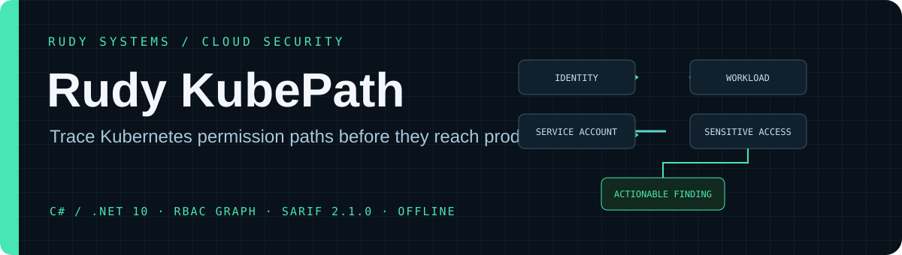

<p align="center">
  
</p>

<p align="center">
  <a href="https://github.com/r4venrudy/rudy-kubepath/actions/workflows/ci.yml"></a>
  
  <a href="LICENSE"></a>
</p>

<p align="center"><strong>Trace how Kubernetes permissions can become workload access, service-account reachability, and sensitive actions.</strong><br>Offline-first analysis for rendered manifests, code review, and CI.</p>

---

## Why KubePath

RBAC reviews are difficult when a principal can change a workload, select a service account, and inherit that account's permissions. KubePath builds an explainable graph from supplied Kubernetes YAML and reports conditional escalation paths alongside direct RBAC risks and workload hardening gaps.

```text
release identity ── can update ──> deployment in payments
                                          │
                                          └── can select ──> payments-api ServiceAccount
                                                                  │
                                                                  └── can read ──> Kubernetes Secrets
```

KubePath follows these paths across namespaces and through intermediate service accounts when the supplied RBAC grants make that path visible. Each result includes the binding, scope, service account, capability, conditions, and remediation suggestions.

## Capabilities

| Area | What it checks |
| --- | --- |
| RBAC graph | Roles, ClusterRoles, RoleBindings, ClusterRoleBindings, wildcards, scope, built-in groups, role reference errors, and duplicate identities. |
| Privilege paths | Workload creation or mutation across core, `apps`, and `batch` APIs; service-account selection; chained service-account reachability; secrets, token creation, impersonation, role escalation, binding changes, node proxy, CSR approval, and pod runtime access. |
| Pod security | Privileged and HostProcess containers, host namespaces and paths, root identities, privilege escalation, dangerous capabilities, seccomp, image digests, read-only root filesystems, resource bounds, and token automount. |
| Namespace posture | Pod Security Admission `enforce` labels and visible NetworkPolicy default-deny coverage. |
| Integration | Human-readable text, JSON, SARIF 2.1.0 for code scanning, Graphviz DOT, and severity-based CI exit codes. |
| Safety | No cluster connection, credentials, workload execution, API calls, or infrastructure changes. Bounded file, document, and container inputs. |

## Quick start

Download the self-contained archive for your platform from [Releases](https://github.com/r4venrudy/rudy-kubepath/releases), extract it, then run:

```sh
./rudy-kubepath analyze ./rendered-manifests --format text
```

On Windows, run `rudy-kubepath.exe` from PowerShell. To analyze the included deliberately unsafe example:

```sh
./rudy-kubepath analyze examples/unsafe-cluster.yaml --format text --fail-on high
```

That example intentionally triggers the gate and exits with status `1`. KubePath uses exit `0` when the configured gate passes, `1` when a finding meets the gate, `2` for usage or incomplete input, and `3` when it cannot write output.

## CI and report formats

Generate a SARIF report for GitHub Code Scanning or another SARIF consumer:

```sh
./rudy-kubepath analyze ./rendered-manifests --format sarif --output kubepath.sarif --fail-on high
```

Build a relationship graph for Graphviz:

```sh
./rudy-kubepath analyze ./rendered-manifests --format dot --output kubepath.dot --fail-on none
dot -Tsvg kubepath.dot -o kubepath.svg
```

Supported report formats are `text`, `json`, `sarif`, and `dot`. Use `--fail-on none|critical|high|medium|low|info` to set a CI gate. `--max-files` adjusts the directory scan limit.

YAML documents wrapped in `kind: List` are analyzed item by item, including nested Lists. Findings retain the containing file/document reference. All inputs share a 5,000 resource/list-node limit; malformed List envelopes produce input findings instead of an empty clean report.

## Build from source

Requirements: .NET 10 SDK.

```sh
dotnet restore tests/Rudy.KubePath.Tests/Rudy.KubePath.Tests.csproj
dotnet build tests/Rudy.KubePath.Tests/Rudy.KubePath.Tests.csproj --configuration Release --no-restore
dotnet test tests/Rudy.KubePath.Tests/Rudy.KubePath.Tests.csproj --configuration Release --no-build
dotnet run --project src/Rudy.KubePath/Rudy.KubePath.csproj -- analyze examples/unsafe-cluster.yaml --format json --fail-on none
```

GitHub Actions builds and tests on Linux, Windows, and macOS. Publishing a GitHub release builds self-contained single-file packages for Windows x64, Linux x64, and macOS ARM64 and attaches SHA-256 checksums.

## Analysis boundaries

KubePath is a static analyzer. Feed it the final YAML produced by your Helm, Kustomize, or deployment pipeline; it does not render charts or fetch cluster state. An inferred path is conditional on admission policy, service-account token availability, API server behavior, and other cluster controls. The result does not establish runtime exploitability, policy enforcement, network reachability, or compliance. Review important findings against the target cluster and its authorization and admission configuration.

NetworkPolicy results describe only what is visible in the provided manifests. CNI behavior, selectors, peer rules, host networking, and platform configuration determine actual traffic isolation. The analyzer also does not resolve external identity-provider groups, aggregated ClusterRoles, all API subresources, mutating admission defaults, or provider-specific authorization extensions. See [checks and limitations](docs/rules.md).

## Project layout

```text
src/Rudy.KubePath/          C# CLI, manifest parser, analyzer, graph, report renderers
tests/Rudy.KubePath.Tests/  Regression tests for RBAC scope, paths, posture, and outputs
examples/                   Synthetic unsafe and hardened manifests
docs/rules.md               Finding catalog and analysis boundaries
.github/workflows/          Cross-platform CI and release packaging
```

## References

- [Kubernetes RBAC reference](https://kubernetes.io/docs/reference/access-authn-authz/rbac/)
- [RBAC good practices](https://kubernetes.io/docs/concepts/security/rbac-good-practices/)
- [Pod Security Standards](https://kubernetes.io/docs/concepts/security/pod-security-standards/)
- [NetworkPolicy](https://kubernetes.io/docs/concepts/services-networking/network-policies/)
- [.NET release and support policy](https://learn.microsoft.com/dotnet/core/releases-and-support)

## License

MIT. See [LICENSE](LICENSE).

